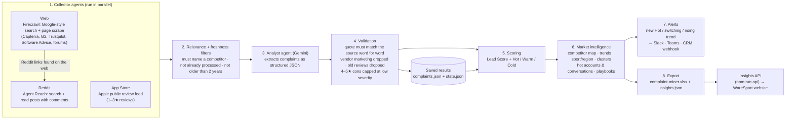

# AI Complaint Miner

**Finds what customers dislike about WareSport's competitors, so sales can lead with it.**

The AI Complaint Miner reads public reviews and discussions about sports-club management
platforms that compete with WareSport (CourtReserve, TeamSnap, Mindbody, Playtomic,
SportsEngine and 17 others). It pulls out genuine complaints, checks every quote word for word
against the original page, scores how promising each one is, and writes everything to one Excel
workbook for the sales team.

On top of the raw complaints it builds **market intelligence**, with no spreadsheet work needed:
- a live **competitor map** with **trend detection**;
- **sport and region filters**;
- **automatic issue clusters**;
- ranked **hot accounts and conversations**;
- auto-generated **sales playbooks**;
- **CRM-ready alerts**.

All of it is available in the workbook, as `insights.json`, and through a read-only **API** the
WareSport website can use. See [docs/10X-GOALS.md](docs/10X-GOALS.md) for where this is heading
and [docs/INTEGRATION.md](docs/INTEGRATION.md) for the website integration.

It is a standalone tool. It does not connect to the WareSport platform, its database or its
customers, and it never posts, comments or contacts anyone. It only reads public content.

---

> **Sales team:** go straight to the [step-by-step setup guide](#start-here-sales-team-setup-guide).

## Contents

- **[Start here: sales team setup guide](#start-here-sales-team-setup-guide)**

1. [Who this is for](#1-who-this-is-for)
2. [For the sales team: using the workbook](#2-for-the-sales-team-using-the-workbook), including [the intelligence sheets](#the-intelligence-sheets-no-filtering-needed)
3. [How it works](#3-how-it-works)
4. [Where the data comes from](#4-where-the-data-comes-from)
5. [Competitors tracked](#5-competitors-tracked)
6. [Quality and trust safeguards](#6-quality-and-trust-safeguards)
7. [Lead tiers and scoring](#7-lead-tiers-and-scoring)
8. [Setup](#8-setup), including [Reddit with Agent Reach](#3-set-up-reddit-with-agent-reach)
9. [Running it](#9-running-it)
10. [Output files](#10-output-files)
11. [Configuration](#11-configuration)
12. [Project structure (for developers)](#12-project-structure-for-developers)
13. [Cost and run time](#13-cost-and-run-time)
14. [Troubleshooting](#14-troubleshooting)
15. [Limits, ethics and data handling](#15-limits-ethics-and-data-handling)
16. [Roadmap](#16-roadmap)

---

## Start here: sales team setup guide

No coding needed. You copy, paste and press Enter. Plan about 30 minutes, once.

### Do you need this setup?

| You want to… | What to do |
|---|---|
| **Only read the results** | **No setup.** Ask the person who runs the tool for the Excel file, then go to [section 2](#2-for-the-sales-team-using-the-workbook) |
| **Collect complaints yourself** | Follow the steps below |

> **Tip:** one person running the tool and sharing the Excel file is simplest. Every run uses paid
> credits, and each computer keeps its own separate results.

### What you need to change: the checklist

| # | What | Where | Must you? |
|---|---|---|---|
| 1 | **Gemini API key** (the AI that reads the complaints) | `.env` file, after `GEMINI_API_KEY=` | **Yes** |
| 2 | **Firecrawl API key** (reads review websites) | `.env` file, after `FIRECRAWL_API_KEY=` | **Yes** |
| 3 | **Reddit login** (your own, not in any file) | Step 6 below | Optional, but Reddit has some of the best complaints |
| 4 | **Slack or Teams alert link** | `.env` file, `COMPLAINT_MINER_WEBHOOK_URL` | Optional. Ask a developer to set it up and test it |

**Leave everything else as it is.** Don't edit any other file or any other line in `.env`.

### Step 1: Install two free programs

| Program | Where | How |
|---|---|---|
| **Node.js** (runs the tool) | [nodejs.org](https://nodejs.org) | Download the **LTS** version, open it, keep clicking **Next** |
| **VS Code** (where you open the tool) | [code.visualstudio.com](https://code.visualstudio.com) | Download, open it, keep clicking **Next** |

Restart your computer when both are installed.

### Step 2: Download the tool

1. Open [the GitHub page](https://github.com/waresport-product/AI-Complaint-miner).
2. Click the green **Code** button, then **Download ZIP**.
3. Right-click the downloaded file and choose **Extract All**.
4. In VS Code, click **File → Open Folder** and choose the extracted folder. Pick the one that
   has `README.md` and `package.json` directly inside it.
5. If VS Code asks whether you trust the authors, click **Yes**.

### Step 3: Install the tool's parts

1. In VS Code, click **Terminal → New Terminal**. A box opens at the bottom. On Windows it should
   say **powershell** at its top right.
2. Paste this and press **Enter**. Wait until it finishes (1–3 minutes):

```powershell
npm.cmd install
```

> **On a Mac**, type `npm` wherever this guide says `npm.cmd`.

### Step 4: Add your keys

A key is like a password that lets the tool use a service. Ask your manager whether to use company
keys or create your own.

| Key | Where to get it | Looks like |
|---|---|---|
| **Gemini** | [aistudio.google.com/apikey](https://aistudio.google.com/apikey) → **Create API key** | A long mix of letters and numbers |
| **Firecrawl** | [firecrawl.dev](https://www.firecrawl.dev) → sign up → **API Keys** | Starts with `fc-` |

1. In the terminal, paste this and press **Enter**. It creates your settings file, called `.env`.
   Do it **once only**: running it again replaces your keys.

```powershell
Copy-Item .env.example .env
```

   On a Mac, use `cp .env.example .env`.

2. Click **`.env`** in the file list on the left (not `.env.example`).
3. Replace only the example text after `=` on these two lines:

```
FIRECRAWL_API_KEY=paste-your-firecrawl-key-here
GEMINI_API_KEY=paste-your-gemini-key-here
```

4. Press **Ctrl + S** (Mac: **Cmd + S**) to save.

| ✅ Right | ❌ Wrong | Why |
|---|---|---|
| `GEMINI_API_KEY=abc123` | `GEMINI_API_KEY = abc123` | No spaces around `=` |
| `GEMINI_API_KEY=abc123` | `# GEMINI_API_KEY=abc123` | A `#` at the start switches the line off |
| `GEMINI_API_KEY=abc123` | `abc123` | Keep the name and the `=` |

> 🔒 **Keep keys private.** Never put them in an email, chat, screenshot or GitHub. If one gets
> out, delete it on the website you got it from and create a new one.

### Step 5: Check that it works (free)

```powershell
npm.cmd run mine -- --list
```

You should see a list of competitors. This checks the installation. Your keys are tested by the
first real run in step 7.

### Step 6: Connect Reddit (optional)

Skip this if you're unsure; everything else still works. Reddit needs one extra free program
called Agent Reach. On Windows, paste these **one at a time** in the same terminal:

| Order | Paste this | What it does |
|---|---|---|
| 1 | `powershell -ExecutionPolicy ByPass -c "irm https://astral.sh/uv/install.ps1 \| iex"` | Installs a helper. **Then close VS Code and open it again** |
| 2 | `uv tool install https://github.com/Panniantong/Agent-Reach/releases/latest/download/agent-reach.zip` | Installs Agent Reach |
| 3 | `agent-reach setup` | First-time setup |
| 4 | `agent-reach add reddit` | Adds Reddit |
| 5 | `agent-reach login reddit` | Opens a browser: **log in to Reddit there**. It may open behind other windows |
| 6 | `agent-reach check reddit --text` | Shows **PASS** or **FAIL** |

Use a spare Reddit account if you can. The tool only reads; it never posts, comments or messages.
Mac steps and more help: [Set up Reddit with Agent Reach](#3-set-up-reddit-with-agent-reach).

### Step 7: Run it

**Close the Excel file first**, then start small, with one competitor:

```powershell
npm.cmd run mine -- --competitors courtreserve --sources web,appstore
```

If that works, choose what you need:

| I want to… | Paste this | Uses credits? |
|---|---|---|
| Check **one** competitor (change the name) | `npm.cmd run mine -- --competitors teamsnap` | Yes, a little |
| Check **a few** | `npm.cmd run mine -- --competitors "teamsnap,mindbody"` | Yes |
| Check **everything** | `npm.cmd run mine` | Yes, the most: about 250 Firecrawl credits and 45 minutes or more |
| Rebuild the Excel file from saved results | `npm.cmd run export` | **No** |
| See competitor names to use | `npm.cmd run mine -- --list` | **No** |

Keep VS Code open and your computer awake until you see **Complaint Miner run complete**. To stop
early, press **Ctrl + C**.

**Did it work?** The tool says *run complete* even if a key is wrong, so check these numbers at
the end:

| Look for | Good | Problem |
|---|---|---|
| `"failed"` | `0` | Higher: usually a wrong Gemini key or its limit. See the table at the end of this guide |
| `"errors"` | `0` | Higher: some pages couldn't be read. A few is normal |
| `"newComplaints"` | Above `0` | `0` is fine if nothing new was posted and `"failed"` is `0` |

### Step 8: Open your results

Open the folder **`output` → `complaint-miner`** and double-click **`complaint-miner.xlsx`**. Then
see [how to use the workbook](#2-for-the-sales-team-using-the-workbook).

**Want the complaints already collected?** They aren't on GitHub, so a new setup starts empty.
Before your first run, ask the person who runs the tool for their `output/complaint-miner` folder
and copy it to the same place in yours. Don't replace your folder after you have run the tool,
because that erases your own results.

### If something goes wrong

| You see | Do this |
|---|---|
| `npm.cmd is not recognized` | Install Node.js (step 1), then restart your computer |
| `Could not read package.json` | You opened the wrong folder. Repeat step 2, part 4 |
| `Cannot find module` | Run `npm.cmd install` again (step 3) |
| `Set GEMINI_API_KEY (or OPENAI_API_KEY)…` | The Gemini key is missing from `.env`, or you didn't save (step 4) |
| `"failed"` is above 0 at the end of a run | Open the newest folder in `output/complaint-miner/runs`, then `report.json`, and find `"errors"` near it. The next two rows explain the common ones |
| `Gemini request failed (400)`, `(401)` or `(403)` | The Gemini key is wrong. Copy it again (step 4) |
| `Gemini request failed (429)` | The Gemini limit was reached. Wait, then run again; nothing is lost |
| `Web skipped: FIRECRAWL_API_KEY is not set` | Add the Firecrawl key (step 4) |
| `Firecrawl … (401)` | The Firecrawl key is wrong. Copy it again (step 4) |
| `Firecrawl … (402)` | Firecrawl credits have run out. Tell your manager |
| `Reddit skipped` | Fine if you skipped step 6. The rest still runs |
| `NEED_LOGIN` | Run `agent-reach login reddit` and log in again |
| Reddit search shows `UPSTREAM_BROKEN` | Reddit search is down for now. Add `--reddit-searches 0` to the end of your `mine` command |
| `complaint-miner.xlsx is open in another program` | Close Excel, then run `npm.cmd run export` |

Still stuck? Send the developer a screenshot of the terminal, **but never of your `.env` file**.

### The rules

- **Never contact the people who wrote the complaints.** Use what you learn with your own prospects.
- **Open the source link before using a quote or a club name.**
- **Alerts marked "Date unknown" may be old.** Check the post first.

---

## 1. Who this is for

| Reader | What to read | What you get |
|---|---|---|
| **Sales team** | The [setup guide](#start-here-sales-team-setup-guide) (only if you run the tool yourself), then sections 2 and 7 | A ranked list of real competitor complaints, with the exact quote and a link to the source, to use in outreach and calls |
| **Manager** | Sections 3, 4, 6, 13 and 15, plus [docs/10X-GOALS.md](docs/10X-GOALS.md) | How the data is gathered, why it can be trusted, what it costs, what it deliberately doesn't do, and the 10x plan |
| **Developers** | Everything, especially 8, 11, 12 and 14, plus [docs/INTEGRATION.md](docs/INTEGRATION.md) | How to install, configure, extend and host it, and how to integrate the insights API into the WareSport website |

---

## 2. For the sales team: using the workbook

The results are in **`output/complaint-miner/complaint-miner.xlsx`**, on the **Complaints**
sheet. Every column header has a hover note (the small red triangle) explaining what it means.

**A good way to work through it:**

1. **Filter `Lead Tier` to *Hot*.** These are serious complaints, mostly from club owners, admins
   or staff, often saying they want to switch.
2. **Filter `Competitor`** to the platform your prospect uses.
3. **Read the `Exact Quote`** and click **`Source URL`** to see the full post in context.
4. **Use `WareSport Angle`** as a starting point for your pitch: a one-line WareSport strength
   that answers that type of problem. Check the wording before quoting it to a prospect.
5. **Look at `Switching Intent`**: *considering* means they're actively looking for alternatives,
   which is the strongest buying signal.

**What the columns mean:**

| Column | Meaning |
|---|---|
| Found On | Date the tool collected this complaint |
| Lead Tier | **Hot / Warm / Cold**: the system's suggested priority (see section 7) |
| Lead Score | The number behind the tier (0–23) |
| Competitor | The platform being complained about |
| Pain Category | Type of problem: Booking & scheduling, Payments & billing, Pricing & fees, Customer support, Reliability & bugs, Ease of use, Communication & notifications, Membership management, Reporting & analytics, Integrations, Onboarding & migration, Contract & lock-in, Missing features, Other |
| Exact Quote | Word-for-word text from the source, **checked automatically against the original page** |
| Pain Summary | A short neutral summary written by the AI (not a quote) |
| Severity (1-5) | 1 = minor annoyance, 3 = recurring problem hurting operations, 5 = losing money/members or leaving. Capped at 2 for complaints from 4–5★ reviews |
| Review Rating | Stars the author gave (1–5). Blank for forum and Reddit posts |
| Switching Intent | *considering* (looking for alternatives), *switched_away* (already left) or *none* |
| Author Type | *club_owner_admin* (decision-maker), *club_staff*, *coach*, *player*, *parent* or *unknown* |
| Location | Only filled when the source states it. Never guessed |
| Sport | Stated in the complaint, or recognised from its text or subreddit (e.g. r/Pickleball). Blank when unknown |
| Source | Where it was found: Reddit (with subreddit), App Store, Capterra, G2, Trustpilot, Software Advice, GetApp, Google Play, … |
| Source URL | Click to open the original post or review |
| Posted On | When the original was written, when the source shows it |
| WareSport Angle | Suggested WareSport talking point for this kind of problem |
| Region | Country or region from a stated location, or the App Store storefront country for app reviews |
| Complaint ID | Internal ID used to avoid duplicates. Not needed by sales |

Each run also saves **`runs/<date-time>/new-complaints.xlsx`** with only that run's new finds,
which is handy for a "what's new this week" review.

### The intelligence sheets (no filtering needed)

The same workbook has five more sheets, rebuilt on every run:

| Sheet | What it answers |
|---|---|
| **Competitor Map** | Which competitors have the most unhappy customers right now? Complaints, Hot, people considering a switch, complaints from owners/staff, top 3 pains, and whether complaints are *rising / falling / new / steady* (last 30 days vs the 60 before) |
| **Issue Clusters** | What are people actually complaining about, across all competitors? E.g. "AI chatbot instead of human support", "Contracts, cancellation & auto-renewal", "In-app ads", each with counts, trend, top competitors and an example quote. *Emerging* clusters are new recurring phrases the system spotted by itself |
| **Playbooks** | How should I pitch against competitor X? Per competitor: the pains to lead with (ranked by evidence), a suggested opener, the WareSport angle, discovery questions, and a proof quote with its link |
| **Hot Conversations** | Where are owners most actively unhappy? Threads and review pages ranked by Hot complaints, switching intent and owner involvement |
| **Alerts** | What's new and urgent? New Hot complaints, people considering a switch, and rising trends. Complaints whose source shows no date are marked *Date unknown* and rank lower. Also sent to Slack, Teams or a CRM if a webhook is set up (section 9) |

Every header has a hover note. Verified club accounts appear only when a club's name is proven by
the source text (see section 6); until then, **Hot Conversations** is the place to find specific
threads to act on.

> **Please close the workbook in Excel before a run.** Excel locks open files. If it's open, the
> run saves a dated copy (`complaint-miner-<date>.xlsx`) instead.

**Running the miner yourself?** Follow the
[sales team setup guide](#start-here-sales-team-setup-guide) once. If someone else runs the miner
and shares the workbook, you don't need any setup.

**Contacting people:** the tool deliberately doesn't collect contact details and isn't built for
emailing reviewers. Use it to understand competitor weaknesses, find which platforms prospects
struggle with, and sharpen your messaging.

---

## 3. How it works



**Step by step:**

1. **Collect.** For each competitor, three collector agents run side by side:
   - **Reddit:** searches Reddit for the competitor's name, keeps only posts that really mention
     it, and reads the most-discussed ones, including comments.
   - **Web:** runs three searches per competitor through Firecrawl:
     a review-site search (Capterra, G2, Software Advice, GetApp, Trustpilot), a complaint-keyword
     search (past year only) and a forums/community search (past year only). It then downloads
     the most relevant pages. Reddit links found here are passed to the Reddit agent, because
     Reddit blocks normal scraping.
   - **App Store:** downloads recent 1–3★ reviews of the competitor's iPhone app from Apple's
     public feed and groups them into batches of 25.
2. **Filter.** Anything that doesn't name a tracked competitor, is older than 2 years, or was
   already processed recently is skipped *before* any AI cost is spent.
3. **Analyze.** Each page or batch is sent to the AI with strict instructions: extract only
   first-hand complaints, copy quotes exactly, never guess a club, date or location, and classify
   the pain, severity, who's speaking and whether they want to switch.
4. **Validate.** Code, not the AI, enforces the rules: quotes must appear word for word in the
   source, and any that don't are thrown away. Vendor marketing pages are discarded. Complaints
   older than the cutoff are dropped. Cons inside 4–5★ reviews are capped at severity 2.
5. **Score.** Each complaint gets a Lead Score and a Hot/Warm/Cold tier (section 7). Scores are
   recalculated on every run because recency changes over time.
6. **Market intelligence.** From every complaint collected so far, the system builds:
   - **Competitor map:** volume, Hot, switching, top pains and trend per competitor.
   - **Trends:** the last 30 days compared with the 60 days before.
   - **Sport and region:** taken from what the source states or clearly shows (the subreddit,
     sport words, the App Store country), each labelled with how it was found.
   - **Issue clusters:** named themes across competitors, plus emerging themes it spots on its own.
   - **Hot accounts and conversations:** clubs only when verified, and the threads with the most
     intent.
   - **Playbooks:** per competitor.

   This step has no AI cost and is deterministic, so results are stable from run to run.
7. **Alerts.** New Hot complaints, people considering a switch, and rising trends are raised
   **once each**, saved to `alerts.json`, and sent to a Slack, Teams or CRM webhook if one is
   configured.
8. **Export.** All complaints found so far, across every run, go into one workbook, best first,
   together with the five intelligence sheets and `insights.json`. Duplicates are merged, so the
   same quote is never listed twice. The **insights API** (`npm run api`) serves the same data to
   the WareSport website.

**Repeat runs only pay for new content.** The tool remembers what it has processed (Reddit posts
for 30 days, web pages for 14 days, App Store reviews permanently). Twice-weekly runs mostly pick
up newly posted complaints and pages that failed last time.

---

## 4. Where the data comes from

| Source | How it's collected | Login or key needed | Notes |
|---|---|---|---|
| **Reddit** | [Agent Reach](https://github.com/Panniantong/Agent-Reach) drives a real, logged-in browser on the machine running the miner | Agent Reach installed, and a Reddit login done once by a person ([setup steps](#3-set-up-reddit-with-agent-reach)) | Reddit blocks normal scrapers, so this is the only reliable path. Search and post reading are separate; if search is down, links found by the web search are still read |
| **Review sites** (Capterra, G2, Software Advice, GetApp, Trustpilot) | Firecrawl search + scrape | `FIRECRAWL_API_KEY` | Many reviews are mostly positive with a "cons" section. The star rating is recorded so these are weighted down |
| **Forums and communities** | Firecrawl search (past year) + scrape | `FIRECRAWL_API_KEY` | Facebook and Instagram can't be scraped and are skipped |
| **Apple App Store** | Apple's free public review feed | None | Up to 100 most recent reviews per app per run. Apple sometimes throttles the feed; the run report warns when that happens |
| **AI analysis** | Google Gemini in JSON mode (`gemini-3.5-flash` by default) | `GEMINI_API_KEY` | OpenAI is supported as a fallback (section 11) |

---

## 5. Competitors tracked

22 platforms in WareSport's space, defined in `src/constants.js` (see section 11 to add more).

| Segment | Competitors |
|---|---|
| **Racquet and court booking** | CourtReserve, PodPlay, Playbypoint, Playtomic, Club Automation, Skedda, ClubSpark, MATCHi |
| **Team, league and youth sports** | TeamSnap, LeagueApps, SportsEngine, Jersey Watch, Upper Hand, PlayMetrics, GotSport, TeamLinkt, Demosphere |
| **Gym, studio and facility** | ClubReady, Jonas Club, Mindbody, Pike13, Daxko |

Run `npm run mine -- --list` to print each competitor's key, which you can use with `--competitors`.

---

## 6. Quality and trust safeguards

| Risk | Safeguard |
|---|---|
| AI invents or paraphrases a quote | Every quote is checked character for character (after normalizing spacing and curly quotes) against the scraped text. Failures are dropped and counted as `quotesRejected` in the run report |
| Search noise (e.g. "Supreme Court … Federal Reserve" matching "Court Reserve") | Whole-word competitor-name matching before any page is read or analyzed |
| Vendor marketing ("Top 10 CourtReserve alternatives" blogs) | The AI classifies these as `vendor_marketing` and all their "complaints" are discarded |
| Old, outdated complaints | Anything posted more than 2 years ago is dropped (`COMPLAINT_MINER_MAX_AGE_DAYS`). Forum searches are limited to the past year |
| Happy customers' minor wishes looking like hot leads | The review's star rating is recorded, and cons from 4–5★ reviews are capped at severity 2 |
| Guessed facts | The AI is told to leave club, location, sport and date blank unless the page states them |
| Duplicate quotes across sites | Same quote about the same product = one complaint |
| Spreadsheet formula injection from scraped text | All cells are written as plain text, never as formulas |
| Hammering websites or getting accounts blocked | Reddit searches are spaced 11 seconds apart and reads 4 seconds apart, one at a time. The Reddit channel stops for the run on login, rate-limit or block errors. Firecrawl backs off and retries on rate limits |

**Club names must be proven.** Testing showed AI-extracted club names can come from a review
headline (e.g. a review titled "The HOP") or can't be traced to the source. So the AI must now
also return the exact sentence that ties the author to the club, and code checks three things:
- the sentence appears **word for word** in the source;
- it **contains the club's name**;
- it says **more than the name alone**, so a bare headline doesn't count.

Only clubs that pass become **hot accounts** or appear in the API. Unverified names are stored but
never shown or scored. This applies to data collected from now on; earlier complaints have no
verified clubs.

---

## 7. Lead tiers and scoring

```
Lead Score (0–23) = Severity × 2                    (2–10)
                  + Who said it                     owner/admin 6 · staff 4 · coach 3 · parent 2 · player 1 · unknown 0
                  + Switching intent                considering 5 · switched away 2 · none 0
                  + Recency                         posted ≤ 90 days ago 2 · ≤ 1 year 1 · older or undated 0
```

| Tier | Score | Typical example |
|---|---|---|
| **Hot** | 16+ | A club owner saying support is unreachable and they're looking at other providers |
| **Warm** | 10–15 | A club admin describing a recurring billing problem |
| **Cold** | below 10 | A player's one-off app glitch |

The tier is a suggestion to help prioritise. Sales should make the final call.

---

## 8. Setup

### Requirements

| Need | Why |
|---|---|
| **Node.js 18+** | Runs the miner |
| **Gemini API key** | AI analysis of complaints |
| **Firecrawl API key** ([firecrawl.dev](https://firecrawl.dev)) | Web search and scraping of review sites and forums |
| **Agent Reach** (optional, for Reddit) | Free Python tool installed with [uv](https://docs.astral.sh/uv/). Full steps in [Set up Reddit with Agent Reach](#3-set-up-reddit-with-agent-reach). Without it, Reddit is skipped with a warning and everything else still runs |

### 1. Install

```bash
git clone https://github.com/waresport-product/AI-Complaint-miner.git
cd AI-Complaint-miner
npm install
```

### 2. Add your keys

```bash
cp .env.example .env        # Windows PowerShell: Copy-Item .env.example .env
```

Open `.env` and fill in:

| Variable | Required | Purpose |
|---|---|---|
| `GEMINI_API_KEY` | Yes | AI analysis |
| `FIRECRAWL_API_KEY` | Yes, for web sources | Review sites and forums |
| `COMPLAINT_MINER_LLM_PROVIDER` | No (default `gemini`) | `gemini` or `openai` |
| `COMPLAINT_MINER_MODEL` | No (default `gemini-3.5-flash`) | Any chat model your key can use |
| `OPENAI_API_KEY` | No | Only if using OpenAI instead of Gemini |
| `COMPLAINT_MINER_MAX_AGE_DAYS` | No (default `730`) | Drop complaints older than this |
| `COMPLAINT_MINER_OUTPUT_DIR` | No (default `output/complaint-miner`) | Where results go |
| `COMPLAINT_MINER_CRON` | No (default `0 8 * * 1,4`) | Schedule for `npm run schedule` (Mon + Thu 08:00) |
| `COMPLAINT_MINER_LLM_CONCURRENCY` | No (default `3`) | Parallel AI calls |
| `AGENT_REACH_BIN` | No (default `agent-reach`) | Path to the Agent Reach command, if it isn't on PATH |

`.env` is git-ignored. **Never commit it or paste keys into chats or tickets.** If a key leaks,
rotate it in the provider's dashboard.

### 3. Set up Reddit with Agent Reach

Reddit is one of the best sources: club owners post detailed rants and "what should we switch to?"
threads there. But Reddit blocks normal scrapers (including Firecrawl), so the miner reads Reddit
through **[Agent Reach](https://github.com/Panniantong/Agent-Reach)**, a free, open-source
command-line tool that drives a real, logged-in browser to search Reddit and read posts **with
their comments**.

**What you need to know first:**

- Agent Reach is **not part of this repo**. It's a separate program installed once on the
  computer that runs the miner. The miner calls it automatically on every run.
- **Only the computer that runs the miner needs it.** We recommend one person (or one shared,
  always-on computer) runs the miner and shares the Excel file. The rest of the sales team then
  needs no setup at all.
- It is **optional**. Without it, the miner prints `Reddit skipped: agent-reach CLI not
  available` and still collects from review sites, forums and the App Store.
- **Windows:** run every command below, and the miner itself, in **PowerShell**. In Git Bash and
  some other terminals, Agent Reach fails with `Unable to create process using …python.exe`.

#### 3a. Install uv (the installer Agent Reach uses)

```powershell
# Windows (PowerShell)
powershell -ExecutionPolicy ByPass -c "irm https://astral.sh/uv/install.ps1 | iex"
```
```bash
# macOS / Linux
curl -LsSf https://astral.sh/uv/install.sh | sh
```

Close and reopen the terminal, then check with `uv --version`.

#### 3b. Install Agent Reach

```bash
# Install from GitHub only. The PyPI package called "agent-reach" is a DIFFERENT project.
uv tool install https://github.com/Panniantong/Agent-Reach/releases/latest/download/agent-reach.zip
agent-reach version        # should print JSON with "ok": true
```

If `agent-reach` isn't found, run `uv tool update-shell`, open a new terminal and try again.

#### 3c. Turn on the Reddit channel

```bash
agent-reach setup          # first-time setup; prints an installation report
agent-reach add reddit     # installs what Reddit needs (Node.js, OpenCLI, a dedicated browser). No admin password
```

#### 3d. Log in to Reddit (a person must do this once)

```bash
agent-reach login reddit
```

A browser window opens on Reddit's login page. It may appear **behind other windows**, so check
the taskbar. Log in there yourself. Agent Reach never asks for or stores your password; the login
is kept in its own browser profile (separate from your normal browser) and reused on every run.

Use a **dedicated or secondary Reddit account** if possible, and don't share the login between
computers.

#### 3e. Check it works

```bash
agent-reach check reddit --text
```

You'll see PASS or FAIL per Reddit action, for example:

```
PASS  reddit search [opencli] …
PASS  reddit subreddit [opencli] …
```

To try reading one post with its comments:

```bash
agent-reach reddit read "https://www.reddit.com/r/Pickleball/comments/<id>/<title>/" --backend opencli
```

#### 3f. What the miner does with Agent Reach on each run

You don't run these yourself; the miner does it automatically during `npm run mine`:

1. **Searches Reddit** for each competitor (2 searches each, spaced 11 seconds apart), e.g.
   `"CourtReserve"` and `CourtReserve pickleball`.
2. **Filters** the results: keeps only posts that really mention the competitor and were posted
   in the last 2 years, and skips posts already read in the last 30 days.
3. **Reads the top posts with their comments** (up to 5 most-discussed per competitor), one at a
   time with a short pause. A read that times out is retried once.
4. **Also reads Reddit links found by the web search**, since Firecrawl can't open them.
5. Passes each post and its comments to the AI, which extracts complaints. Quotes from comments
   are checked word for word like any other source.
6. **Stops using Reddit for that run** if Agent Reach reports `NEED_LOGIN`, `RATE_LIMITED`,
   `PLATFORM_BLOCKED` or `BUSY`, instead of hammering Reddit. The rest of the run continues.

Agent Reach is **read-only**: the miner never posts, comments, votes or messages anyone.

#### 3g. Keeping it working

| Situation | What to do |
|---|---|
| Run report shows `NEED_LOGIN` | Session expired: run `agent-reach login reddit` and log in again |
| Reddit search fails with `UPSTREAM_BROKEN … "<body clas…" is not valid JSON` | Reddit is blocking search for now (reading posts usually still works). Run `npm run mine -- --reddit-searches 0` until `agent-reach check reddit --text` shows search as PASS again |
| Something seems broken | `agent-reach doctor --text` shows the status of every channel |
| Occasionally (e.g. monthly) | `agent-reach update` keeps the tool and its browser parts current |
| Moving the miner to another computer | Repeat steps 3a–3e there. The Reddit login doesn't transfer |

### 4. Check it works

```bash
npm test                                                  # unit tests, no network or keys needed
npm run mine -- --dry-run --competitors courtreserve      # collects real data, no AI cost
```

---

## 9. Running it

| Command | What it does |
|---|---|
| `npm run mine` | **Full run:** all competitors, all sources, then updates the workbook |
| `npm run mine -- --competitors teamsnap,mindbody` | Only some competitors (keys from `--list`) |
| `npm run mine -- --sources web,appstore` | Only some sources (`reddit`, `web`, `appstore`) |
| `npm run mine -- --reddit-searches 0` | Skip Reddit search but still read Reddit links found on the web. Use when Reddit search is down |
| `npm run mine -- --dry-run` | Collect only, no AI calls. Writes `runs/<date>/documents.xlsx` listing what *would* be analyzed |
| `npm run export` (or `npm run insights`) | Rebuild the workbook, `insights.json` and alerts from saved results, with no scraping and no cost |
| `npm run api` | Start the read-only insights API for the website or a dashboard (see [docs/INTEGRATION.md](docs/INTEGRATION.md)) |
| `npm run schedule` | Run automatically twice a week (Mon + Thu 08:00). Keep the window open |
| `npm run mine -- --list` | List competitor keys |
| `npm test` | Run the automated tests |

Other options: `--out <folder>`, `--reddit-reads <n>` (posts read per competitor, default 5),
`--web-pages <n>` (pages scraped per competitor, default 6).

**What a run prints:** progress lines, then a summary of documents collected, complaints found,
quotes rejected, too-old complaints dropped, warnings (e.g. Apple throttling, workbook open in
Excel) and the paths of the files written. Full details are in `runs/<date>/report.json`.

**Failed items are retried automatically next run.** Pages or posts that fail (network blips,
rate limits) aren't marked as processed, so the next run picks them up.

**Alerts to Slack, Teams or a CRM:** set `COMPLAINT_MINER_WEBHOOK_URL` in `.env` to a Slack or
Teams incoming-webhook URL, or to a Zapier, Make or HubSpot workflow URL. After each run, new
alerts are posted there once. If delivery fails they retry on the next run. Without a webhook,
alerts are kept in `alerts.json` and on the **Alerts** sheet. The payload format is in
[docs/INTEGRATION.md](docs/INTEGRATION.md#7-alerts-to-slack-teams-or-crm).

---

## 10. Output files

Everything is under `output/complaint-miner/` (git-ignored):

| File | Purpose | Keep it? |
|---|---|---|
| `complaint-miner.xlsx` | **The sales workbook**: every complaint so far, best first, plus the five intelligence sheets | Yes |
| `insights.json` | Competitor map, trends, clusters, accounts, conversations and playbooks as JSON (`schemaVersion` 1) for the website or API | Rebuilt every run |
| `alerts.json` | Alerts already raised (so each fires once) and recent alert history | **Yes**: deleting it re-raises old alerts |
| `runs/<date-time>/new-complaints.xlsx` | Only what that run added | Optional |
| `runs/<date-time>/report.json` | Per-source stats, warnings and errors for that run | Optional |
| `complaints.json` | All saved complaints. The workbook is rebuilt from this | **Yes**: deleting it loses history |
| `state.json` | What has been processed, so runs don't pay twice | **Yes**: deleting it makes the next run re-process everything |

To start completely fresh, move the whole `output/complaint-miner` folder somewhere else.

---

## 11. Configuration

Most tuning is in **`src/constants.js`**.

### Add or change a competitor

Add an entry to `COMPETITORS`:

```js
{
    key: "newtool",                         // used with --competitors
    name: "NewTool",                        // shown in the workbook
    segment: SEGMENTS.racquet,              // racquet | team_league | facility
    aliases: ["NewTool", "New Tool"],       // spellings people use; also the relevance filter
    domains: ["newtool.com"],               // the competitor's own site, never treated as a complaint
    appStore: { term: "NewTool", match: ["newtool"] },  // or null if there's no iPhone app
    contextTerms: ["pickleball", "club"],   // added to Reddit searches to reduce noise
},
```

Avoid aliases that are common words (e.g. "Upper Hand" on its own) or results get noisy.

### Other settings (`DEFAULTS` in `src/constants.js`)

| Setting | Default | Meaning |
|---|---|---|
| `maxReviewAgeDays` | 730 | Drop complaints older than this (also `COMPLAINT_MINER_MAX_AGE_DAYS`) |
| `webRecentTbs` | `qdr:y` | Time filter for forum and keyword searches (past year) |
| `webSearchLimit` / `webScrapesPerCompetitor` | 8 / 6 | Search results requested / pages scraped per competitor |
| `redditQueriesPerCompetitor` / `redditReadsPerCompetitor` | 2 / 5 | Reddit searches / posts read per competitor |
| `appStoreCountries` / `appStorePages` / `appStoreMaxRating` | `["us"]` / 2 / 3 | App Store countries, pages of 50 reviews, highest star rating kept |
| `agentReachSearchSpacingMs` / `agentReachReadSpacingMs` / `agentReachRetryWaitMs` | 11000 / 4000 / 20000 | Politeness delays for Reddit |
| `llmModels` | `gemini-3.5-flash` / `gpt-4o-mini` | Default model per provider |
| `llmConcurrency` / `llmMaxCharsPerChunk` / `maxDocCharsTotal` | 3 / 12000 / 36000 | AI parallelism and how much text is sent per page |

Other things you can edit:

- **`WEB_QUERY_TEMPLATES`:** the three web searches run per competitor.
- **`PAIN_CATEGORIES`:** complaint categories.
- **`WARESPORT_ANGLES`:** the talking point shown for each category. Keep these accurate to
  WareSport's current features.

---

## 12. Project structure (for developers)

```
├── docs/
│   ├── 10X-GOALS.md             10x / 100x goals, baseline, targets, phased plan
│   └── INTEGRATION.md           how to integrate the insights API into the WareSport website
├── scripts/
│   ├── run.js                   CLI entry point (flags → ComplaintMinerService.run)
│   ├── schedule.js              node-cron wrapper for twice-weekly runs
│   └── api.js                   starts the read-only insights API
├── src/
│   ├── constants.js             competitors, categories, talking points, search templates, defaults
│   ├── clients/                 external services
│   │   ├── agent-reach-client.js  runs the agent-reach CLI, parses its JSON, maps error codes
│   │   ├── firecrawl-client.js    Firecrawl /search + /scrape with rate-limit backoff
│   │   ├── app-store-client.js    iTunes Search API + customer-review RSS feed
│   │   └── llm-client.js          Gemini (default) / OpenAI JSON-mode completion
│   ├── collectors/              one collector agent per source → "documents"
│   │   ├── reddit-collector.js
│   │   ├── web-collector.js
│   │   └── app-store-collector.js
│   ├── services/
│   │   ├── complaint-miner-service.js    orchestrator: collect → analyze → score → insights → alerts → export
│   │   ├── complaint-analyzer-service.js prompt + validation (verbatim quotes, dates, ratings, verified clubs)
│   │   └── lead-builder-service.js       lead score / tier, per-club grouping (verified clubs only)
│   ├── insights/                market intelligence (pure functions, no network/LLM)
│   │   ├── index.js               buildInsights(complaints, { filters }) → the full payload
│   │   ├── enrich.js              sport + region with provenance, segment, post month
│   │   ├── filters.js             competitor / segment / sport / region / source / tier / intent / pain / since
│   │   ├── trends.js              30-day vs prior-60-day trends, movers, 12-month series
│   │   ├── clusters.js            named issue themes + emerging themes
│   │   ├── accounts.js            verified hot accounts + hot conversations
│   │   ├── playbooks.js           per-competitor sales playbooks
│   │   └── config.js              thresholds, theme dictionary, sport/region patterns, discovery questions
│   ├── alerts/index.js          CRM-ready alerts, dedupe, webhook delivery with retry
│   ├── alerts/confidence.js     marks undated alerts and ranks them lower
│   ├── api/server.js            read-only JSON API (node:http, token, CORS)
│   ├── stores/
│   │   ├── file-store.js        JSON state: processed items + all complaints
│   │   └── alert-store.js       alerts already raised + history
│   ├── exporters/
│   │   ├── excel-exporter.js    workbook (columns, header notes, tier colours, links) + insights.json
│   │   └── insight-sheets.js    Competitor Map, Issue Clusters, Playbooks, Hot Conversations, Alerts
│   └── helpers/                 text matching, dates, chunking, concurrency
├── tests/                       Jest unit tests (all network/AI calls mocked)
├── .env.example                 template for .env
└── package.json
```

**Key internal shapes:**

- A **document** (collector output) is `{ id, source, sourceLabel, url, title, text, publishedAt,
  competitorKeys, segments? }`. `segments` keeps per-review URL, date and rating for batched App
  Store reviews.
- A **complaint** (analyzer output) is `{ id, competitorKey, competitorName, quote, painSummary,
  painCategory, severity, reviewRating, switchingIntent, authorType, organization, location,
  sport, source, sourceLabel, url, publishedAt, foundAt, waresportAngle }`. `leadScore` and
  `leadTier` are added at export time.

**Swappable parts:** `ComplaintMinerService.run()` accepts `store`, `exporter` and `sources`, so a
database store (implementing `load / hasProcessed / markProcessed / addComplaints /
allComplaints / save`) or a Google Sheets exporter (implementing `write` / `writeDocuments`)
can be plugged in without touching the collectors or the analyzer.

**Tests:** `npm test` runs 69 unit tests. They cover:
- relevance matching, quote verification, club verification, date parsing and age cutoff, rating
  caps, Reddit retry and stop rules, and URL classification;
- sport and region inference, filters, trend rules, issue clusters, accounts and conversations,
  and playbooks;
- alerts (dedupe, webhook delivery, retry on failure) and the API (filters, token, read-only, no
  unverified clubs);
- Excel output (all sheets, notes, links, no formulas);
- an end-to-end pipeline with mocked services.

---

## 13. Cost and run time

Measured on real runs in October 2026:

| Run | Firecrawl credits | AI tokens | Time |
|---|---|---|---|
| First full run, 14 competitors | ~120 | ~1M | ~35 min |
| Follow-up, 22 competitors (new competitors + retries) | ~250 | ~1.7M | ~45 min |
| Typical twice-weekly run after that | lower, because processed pages are skipped | lower | 30–60 min (mostly Reddit politeness delays) |

- **Firecrawl:** about 2 credits per search and 1 per page. Watch your monthly plan allowance.
  Reduce `--web-pages` if credits get tight.
- **Gemini:** billed per token on your Google plan; check its current price and rate limits for the
  token volumes above.
- **App Store and Reddit:** no API cost.

---

## 14. Troubleshooting

| Symptom | Likely cause | Fix |
|---|---|---|
| `Set GEMINI_API_KEY (or OPENAI_API_KEY)…` | No AI key in `.env` | Add `GEMINI_API_KEY`, or use `--dry-run` / `npm run export` |
| `Web skipped: FIRECRAWL_API_KEY is not set` | No Firecrawl key | Add it to `.env` |
| `Reddit skipped: agent-reach CLI not available` | Agent Reach missing, or not on PATH in this terminal | Install it ([steps](#3-set-up-reddit-with-agent-reach)), use PowerShell on Windows, or set `AGENT_REACH_BIN` |
| `Unable to create process using …python.exe` | uv launcher issue in Git Bash and some terminals | Run from PowerShell |
| Reddit `NEED_LOGIN` and the channel stops | Reddit session expired | `agent-reach login reddit` and log in again |
| Reddit search `UPSTREAM_BROKEN … "<body clas…" is not valid JSON` | Reddit is blocking search for now (reading posts usually still works) | Run with `--reddit-searches 0`. Check later with `agent-reach check reddit --text` |
| `App Store feed … came back empty … Apple may be throttling` | Apple rate-limited the feed | Re-run later. Nothing is lost |
| `Firecrawl … 429 Rate limit exceeded` (after retries) | Plan's per-minute limit | Re-run later; failed pages are retried. Lower `--web-pages` |
| `Firecrawl … getaddrinfo ENOTFOUND` | Network or DNS outage during the run | Re-run when online |
| `Firecrawl /scrape failed (403)` | Site not supported by Firecrawl | Ignored automatically for known sites (Facebook, Instagram, …) |
| `complaint-miner.xlsx is open in another program` | Workbook open in Excel | Close Excel, then `npm run export` |
| Many complaints have no date | Reddit posts found via web search don't carry a date | Expected for now (see roadmap). Links are still valid |

For more detail, open `output/complaint-miner/runs/<date>/report.json`, which has per-source counts
and every error.

---

## 15. Limits, ethics and data handling

- **Public content only, read-only.** No posting, commenting, liking, messaging or contacting
  reviewers. No passwords are handled by the tool; the Reddit login is done by a person in
  Agent Reach's own browser.
- **Polite collection.** Requests are spaced and limited, and a source stops on block,
  rate-limit or login errors instead of retrying aggressively.
- **Data stays local.** Scraped text and results are kept in `output/` on the machine that runs
  the miner and are git-ignored. Only the configured AI provider sees page text, for analysis.
- **Not collected:** Google Maps reviews (the Places API returns only 5 per place), private
  Facebook groups (membership required; scraping breaks Facebook's terms), Facebook and Instagram
  pages (Firecrawl can't read them), Google Play reviews in bulk (no free official API).
- **Respect site terms.** If the tool is moved to a server or scaled up, review each source's
  terms of service. For example, Reddit's official Data API has its own commercial-use terms.

---

## 16. Roadmap

The full plan, with measurable 10x targets and the 100x stretch, is in
[docs/10X-GOALS.md](docs/10X-GOALS.md). Phase 1 is built: competitor map, trends, sport and region
filters, issue clusters, verified accounts, hot conversations, playbooks, CRM-ready alerts and
the insights API. Next up:

| Item | Why |
|---|---|
| **Always-on daily runs + webhook to the sales channel** | Alerts within 24 hours instead of days |
| **WareSport admin dashboard** (dev team, via the API) | Insights inside the product, no spreadsheet |
| **Feedback on alerts and playbooks** | Measure usefulness; tune scoring |
| **Dates for Reddit posts found via web search** | Read the post date during the Reddit read, so these aren't "undated" (and count in trends) |
| **Google Sheets export** | Share live results without passing Excel files around |
| **Hosting** | Run `npm run schedule` on a small always-on machine or VM with Agent Reach logged in. Agent Reach needs a real browser profile, so it can't run in serverless functions; the alternative is Reddit's official Data API |
| **Database store** | Replace `FileStore` for multi-user or hosted use |
