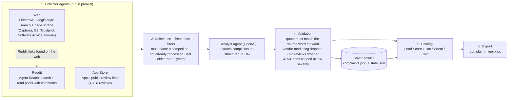

# AI Complaint Miner

**Finds what customers dislike about WareSport's competitors, so sales can lead with it.**

The AI Complaint Miner reads public reviews and discussions about sports-club management
platforms that compete with WareSport (CourtReserve, TeamSnap, Mindbody, Playtomic,
SportsEngine and 17 others). It pulls out genuine complaints, checks every quote word for word
against the original page, scores how promising each one is, and writes everything to one Excel
workbook for the sales team.

It is a standalone tool. It does not connect to the WareSport platform, its database or its
customers, and it never posts, comments or contacts anyone. It only reads public content.

---

## Contents

1. [Who this is for](#1-who-this-is-for)
2. [For the sales team: using the workbook](#2-for-the-sales-team-using-the-workbook)
3. [How it works](#3-how-it-works)
4. [Where the data comes from](#4-where-the-data-comes-from)
5. [Competitors tracked](#5-competitors-tracked)
6. [Quality and trust safeguards](#6-quality-and-trust-safeguards)
7. [Lead tiers and scoring](#7-lead-tiers-and-scoring)
8. [Setup](#8-setup)
9. [Running it](#9-running-it)
10. [Output files](#10-output-files)
11. [Configuration](#11-configuration)
12. [Project structure (for developers)](#12-project-structure-for-developers)
13. [Cost and run time](#13-cost-and-run-time)
14. [Troubleshooting](#14-troubleshooting)
15. [Limits, ethics and data handling](#15-limits-ethics-and-data-handling)
16. [Roadmap](#16-roadmap)

---

## 1. Who this is for

| Reader | What to read | What you get |
|---|---|---|
| **Sales team** | Sections 2, 7 and 9 (first two commands) | A ranked list of real competitor complaints, with the exact quote and a link to the source, to use in outreach and calls |
| **Manager** | Sections 3, 4, 6, 13 and 15 | How the data is gathered, why it can be trusted, what it costs and what it deliberately doesn't do |
| **Developers** | Everything, especially 8, 11, 12 and 14 | How to install, configure, extend and host it |

---

## 2. For the sales team: using the workbook

The results are in **`output/complaint-miner/complaint-miner.xlsx`**, on the **Complaints**
sheet. Every column header has a hover note (the small red triangle) explaining what it means.

**A good way to work through it:**

1. **Filter `Lead Tier` to *Hot*.** These are serious complaints, mostly from club owners, admins
   or staff, often saying they want to switch.
2. **Filter `Competitor`** to the platform your prospect uses.
3. **Read the `Exact Quote`** and click **`Source URL`** to see the full post in context.
4. **Use `WareSport Angle`** as a starting point for your pitch: a one-line WareSport strength
   that answers that type of problem. Check the wording before quoting it to a prospect.
5. **Look at `Switching Intent`**: *considering* means they're actively looking for alternatives,
   which is the strongest buying signal.

**What the columns mean:**

| Column | Meaning |
|---|---|
| Found On | Date the tool collected this complaint |
| Lead Tier | **Hot / Warm / Cold**: the system's suggested priority (see section 7) |
| Lead Score | The number behind the tier (0–23) |
| Competitor | The platform being complained about |
| Pain Category | Type of problem: Booking & scheduling, Payments & billing, Pricing & fees, Customer support, Reliability & bugs, Ease of use, Communication & notifications, Membership management, Reporting & analytics, Integrations, Onboarding & migration, Contract & lock-in, Missing features, Other |
| Exact Quote | Word-for-word text from the source, **checked automatically against the original page** |
| Pain Summary | A short neutral summary written by the AI (not a quote) |
| Severity (1-5) | 1 = minor annoyance, 3 = recurring problem hurting operations, 5 = losing money/members or leaving. Capped at 2 for complaints from 4–5★ reviews |
| Review Rating | Stars the author gave (1–5). Blank for forum and Reddit posts |
| Switching Intent | *considering* (looking for alternatives), *switched_away* (already left) or *none* |
| Author Type | *club_owner_admin* (decision-maker), *club_staff*, *coach*, *player*, *parent* or *unknown* |
| Location / Sport | Only filled when the source states it. Never guessed |
| Source | Where it was found: Reddit (with subreddit), App Store, Capterra, G2, Trustpilot, Software Advice, GetApp, Google Play, … |
| Source URL | Click to open the original post or review |
| Posted On | When the original was written, when the source shows it |
| WareSport Angle | Suggested WareSport talking point for this kind of problem |
| Complaint ID | Internal ID used to avoid duplicates. Not needed by sales |

Each run also saves **`runs/<date-time>/new-complaints.xlsx`** with only that run's new finds,
which is handy for a "what's new this week" review.

> **Please close the workbook in Excel before a run.** Excel locks open files. If it's open, the
> run saves a dated copy (`complaint-miner-<date>.xlsx`) instead.

**Contacting people:** the tool deliberately doesn't collect contact details and isn't built for
emailing reviewers. Use it to understand competitor weaknesses, find which platforms prospects
struggle with, and sharpen your messaging.

---

## 3. How it works



**Step by step:**

1. **Collect.** For each competitor, three collector agents run side by side:
   - **Reddit:** searches Reddit for the competitor's name, keeps only posts that really mention
     it, and reads the most-discussed ones, including comments.
   - **Web:** runs three searches per competitor through Firecrawl:
     a review-site search (Capterra, G2, Software Advice, GetApp, Trustpilot), a complaint-keyword
     search (past year only) and a forums/community search (past year only). It then downloads
     the most relevant pages. Reddit links found here are passed to the Reddit agent, because
     Reddit blocks normal scraping.
   - **App Store:** downloads recent 1–3★ reviews of the competitor's iPhone app from Apple's
     public feed and groups them into batches of 25.
2. **Filter.** Anything that doesn't name a tracked competitor, is older than 2 years, or was
   already processed recently is skipped *before* any AI cost is spent.
3. **Analyze.** Each page or batch is sent to the AI with strict instructions: extract only
   first-hand complaints, copy quotes exactly, never guess a club, date or location, and classify
   the pain, severity, who's speaking and whether they want to switch.
4. **Validate.** Code, not the AI, enforces the rules: quotes must appear word for word in the
   source, and any that don't are thrown away. Vendor marketing pages are discarded. Complaints
   older than the cutoff are dropped. Cons inside 4–5★ reviews are capped at severity 2.
5. **Score.** Each complaint gets a Lead Score and a Hot/Warm/Cold tier (section 7). Scores are
   recalculated on every run because recency changes over time.
6. **Export.** All complaints found so far, across every run, go into one workbook, best first.
   Duplicates are merged, so the same quote is never listed twice.

**Repeat runs only pay for new content.** The tool remembers what it has processed (Reddit posts
for 30 days, web pages for 14 days, App Store reviews permanently). Twice-weekly runs mostly pick
up newly posted complaints and pages that failed last time.

---

## 4. Where the data comes from

| Source | How it's collected | Login or key needed | Notes |
|---|---|---|---|
| **Reddit** | [Agent Reach](https://github.com/Panniantong/Agent-Reach) drives a real, logged-in browser on the machine running the miner | Agent Reach installed, and a Reddit login done once by a person | Reddit blocks normal scrapers, so this is the only reliable path. Search and post reading are separate; if search is down, links found by the web search are still read |
| **Review sites** (Capterra, G2, Software Advice, GetApp, Trustpilot) | Firecrawl search + scrape | `FIRECRAWL_API_KEY` | Many reviews are mostly positive with a "cons" section. The star rating is recorded so these are weighted down |
| **Forums and communities** | Firecrawl search (past year) + scrape | `FIRECRAWL_API_KEY` | Facebook and Instagram can't be scraped and are skipped |
| **Apple App Store** | Apple's free public review feed | None | Up to 100 most recent reviews per app per run. Apple sometimes throttles the feed; the run report warns when that happens |
| **AI analysis** | OpenAI chat completions in JSON mode (`gpt-4o-mini` by default) | `OPENAI_API_KEY` | Gemini is supported as a fallback (section 11) |

---

## 5. Competitors tracked

22 platforms in WareSport's space, defined in `src/constants.js` (see section 11 to add more).

| Segment | Competitors |
|---|---|
| **Racquet and court booking** | CourtReserve, PodPlay, Playbypoint, Playtomic, Club Automation, Skedda, ClubSpark, MATCHi |
| **Team, league and youth sports** | TeamSnap, LeagueApps, SportsEngine, Jersey Watch, Upper Hand, PlayMetrics, GotSport, TeamLinkt, Demosphere |
| **Gym, studio and facility** | ClubReady, Jonas Club, Mindbody, Pike13, Daxko |

Run `npm run mine -- --list` to print each competitor's key, which you can use with `--competitors`.

---

## 6. Quality and trust safeguards

| Risk | Safeguard |
|---|---|
| AI invents or paraphrases a quote | Every quote is checked character for character (after normalizing spacing and curly quotes) against the scraped text. Failures are dropped and counted as `quotesRejected` in the run report |
| Search noise (e.g. "Supreme Court … Federal Reserve" matching "Court Reserve") | Whole-word competitor-name matching before any page is read or analyzed |
| Vendor marketing ("Top 10 CourtReserve alternatives" blogs) | The AI classifies these as `vendor_marketing` and all their "complaints" are discarded |
| Old, outdated complaints | Anything posted more than 2 years ago is dropped (`COMPLAINT_MINER_MAX_AGE_DAYS`). Forum searches are limited to the past year |
| Happy customers' minor wishes looking like hot leads | The review's star rating is recorded, and cons from 4–5★ reviews are capped at severity 2 |
| Guessed facts | The AI is told to leave club, location, sport and date blank unless the page states them |
| Duplicate quotes across sites | Same quote about the same product = one complaint |
| Spreadsheet formula injection from scraped text | All cells are written as plain text, never as formulas |
| Hammering websites or getting accounts blocked | Reddit searches are spaced 11 seconds apart and reads 4 seconds apart, one at a time. The Reddit channel stops for the run on login, rate-limit or block errors. Firecrawl backs off and retries on rate limits |

**Club names are on hold.** The AI also extracts a club or organization name, but testing showed
it can come from a review headline or can't be traced back to the source. It is stored but **not
shown or scored** until it can be verified the same way quotes are (see the roadmap).

---

## 7. Lead tiers and scoring

```
Lead Score (0–23) = Severity × 2                    (2–10)
                  + Who said it                     owner/admin 6 · staff 4 · coach 3 · parent 2 · player 1 · unknown 0
                  + Switching intent                considering 5 · switched away 2 · none 0
                  + Recency                         posted ≤ 90 days ago 2 · ≤ 1 year 1 · older or undated 0
```

| Tier | Score | Typical example |
|---|---|---|
| **Hot** | 16+ | A club owner saying support is unreachable and they're looking at other providers |
| **Warm** | 10–15 | A club admin describing a recurring billing problem |
| **Cold** | below 10 | A player's one-off app glitch |

The tier is a suggestion to help prioritise. Sales should make the final call.

---

## 8. Setup

### Requirements

| Need | Why |
|---|---|
| **Node.js 18+** | Runs the miner |
| **OpenAI API key** | AI analysis of complaints |
| **Firecrawl API key** ([firecrawl.dev](https://firecrawl.dev)) | Web search and scraping of review sites and forums |
| **Agent Reach** (optional, for Reddit) | Python tool installed with [uv](https://docs.astral.sh/uv/). Without it, Reddit is skipped with a warning and everything else still runs |

### 1. Install

```bash
git clone https://github.com/waresport-product/AI-Complaint-miner.git
cd AI-Complaint-miner
npm install
```

### 2. Add your keys

```bash
cp .env.example .env        # Windows PowerShell: Copy-Item .env.example .env
```

Open `.env` and fill in:

| Variable | Required | Purpose |
|---|---|---|
| `OPENAI_API_KEY` | Yes | AI analysis |
| `FIRECRAWL_API_KEY` | Yes, for web sources | Review sites and forums |
| `COMPLAINT_MINER_LLM_PROVIDER` | No (default `openai`) | `openai` or `gemini` |
| `COMPLAINT_MINER_MODEL` | No (default `gpt-4o-mini`) | Any chat model your key can use |
| `GEMINI_API_KEY` | No | Only if using Gemini instead of OpenAI |
| `COMPLAINT_MINER_MAX_AGE_DAYS` | No (default `730`) | Drop complaints older than this |
| `COMPLAINT_MINER_OUTPUT_DIR` | No (default `output/complaint-miner`) | Where results go |
| `COMPLAINT_MINER_CRON` | No (default `0 8 * * 1,4`) | Schedule for `npm run schedule` (Mon + Thu 08:00) |
| `COMPLAINT_MINER_LLM_CONCURRENCY` | No (default `3`) | Parallel AI calls |
| `AGENT_REACH_BIN` | No (default `agent-reach`) | Path to the Agent Reach command, if it isn't on PATH |

`.env` is git-ignored. **Never commit it or paste keys into chats or tickets.** If a key leaks,
rotate it in the provider's dashboard.

### 3. Set up Reddit (optional)

```bash
# Install from GitHub only. The PyPI package called "agent-reach" is a different project.
uv tool install https://github.com/Panniantong/Agent-Reach/releases/latest/download/agent-reach.zip
agent-reach setup
agent-reach add reddit
agent-reach login reddit        # a browser window opens; a person logs in to Reddit there
agent-reach check reddit --text # PASS/FAIL per Reddit action (search, subreddit, …)
```

The login is saved in Agent Reach's own browser profile and reused on later runs. Use a
dedicated or secondary Reddit account if possible.

> **Windows:** run Agent Reach and the miner from **PowerShell**. From Git Bash and some other
> terminals, the uv launcher fails with "Unable to create process using …python.exe".

### 4. Check it works

```bash
npm test                                                  # unit tests, no network or keys needed
npm run mine -- --dry-run --competitors courtreserve      # collects real data, no AI cost
```

---

## 9. Running it

| Command | What it does |
|---|---|
| `npm run mine` | **Full run:** all competitors, all sources, then updates the workbook |
| `npm run mine -- --competitors teamsnap,mindbody` | Only some competitors (keys from `--list`) |
| `npm run mine -- --sources web,appstore` | Only some sources (`reddit`, `web`, `appstore`) |
| `npm run mine -- --reddit-searches 0` | Skip Reddit search but still read Reddit links found on the web. Use when Reddit search is down |
| `npm run mine -- --dry-run` | Collect only, no AI calls. Writes `runs/<date>/documents.xlsx` listing what *would* be analyzed |
| `npm run export` | Rebuild the workbook from saved results, with no scraping and no cost |
| `npm run schedule` | Run automatically twice a week (Mon + Thu 08:00). Keep the window open |
| `npm run mine -- --list` | List competitor keys |
| `npm test` | Run the automated tests |

Other options: `--out <folder>`, `--reddit-reads <n>` (posts read per competitor, default 5),
`--web-pages <n>` (pages scraped per competitor, default 6).

**What a run prints:** progress lines, then a summary of documents collected, complaints found,
quotes rejected, too-old complaints dropped, warnings (e.g. Apple throttling, workbook open in
Excel) and the paths of the files written. Full details are in `runs/<date>/report.json`.

**Failed items are retried automatically next run.** Pages or posts that fail (network blips,
rate limits) aren't marked as processed, so the next run picks them up.

---

## 10. Output files

Everything is under `output/complaint-miner/` (git-ignored):

| File | Purpose | Keep it? |
|---|---|---|
| `complaint-miner.xlsx` | **The sales workbook**: every complaint so far, best first | Yes |
| `runs/<date-time>/new-complaints.xlsx` | Only what that run added | Optional |
| `runs/<date-time>/report.json` | Per-source stats, warnings and errors for that run | Optional |
| `complaints.json` | All saved complaints. The workbook is rebuilt from this | **Yes**: deleting it loses history |
| `state.json` | What has been processed, so runs don't pay twice | **Yes**: deleting it makes the next run re-process everything |

To start completely fresh, move the whole `output/complaint-miner` folder somewhere else.

---

## 11. Configuration

Most tuning is in **`src/constants.js`**.

### Add or change a competitor

Add an entry to `COMPETITORS`:

```js
{
    key: "newtool",                         // used with --competitors
    name: "NewTool",                        // shown in the workbook
    segment: SEGMENTS.racquet,              // racquet | team_league | facility
    aliases: ["NewTool", "New Tool"],       // spellings people use; also the relevance filter
    domains: ["newtool.com"],               // the competitor's own site, never treated as a complaint
    appStore: { term: "NewTool", match: ["newtool"] },  // or null if there's no iPhone app
    contextTerms: ["pickleball", "club"],   // added to Reddit searches to reduce noise
},
```

Avoid aliases that are common words (e.g. "Upper Hand" on its own) or results get noisy.

### Other settings (`DEFAULTS` in `src/constants.js`)

| Setting | Default | Meaning |
|---|---|---|
| `maxReviewAgeDays` | 730 | Drop complaints older than this (also `COMPLAINT_MINER_MAX_AGE_DAYS`) |
| `webRecentTbs` | `qdr:y` | Time filter for forum and keyword searches (past year) |
| `webSearchLimit` / `webScrapesPerCompetitor` | 8 / 6 | Search results requested / pages scraped per competitor |
| `redditQueriesPerCompetitor` / `redditReadsPerCompetitor` | 2 / 5 | Reddit searches / posts read per competitor |
| `appStoreCountries` / `appStorePages` / `appStoreMaxRating` | `["us"]` / 2 / 3 | App Store countries, pages of 50 reviews, highest star rating kept |
| `agentReachSearchSpacingMs` / `agentReachReadSpacingMs` / `agentReachRetryWaitMs` | 11000 / 4000 / 20000 | Politeness delays for Reddit |
| `llmModels` | `gpt-4o-mini` / `gemini-3.5-flash` | Default model per provider |
| `llmConcurrency` / `llmMaxCharsPerChunk` / `maxDocCharsTotal` | 3 / 12000 / 36000 | AI parallelism and how much text is sent per page |

Other things you can edit:

- **`WEB_QUERY_TEMPLATES`:** the three web searches run per competitor.
- **`PAIN_CATEGORIES`:** complaint categories.
- **`WARESPORT_ANGLES`:** the talking point shown for each category. Keep these accurate to
  WareSport's current features.

---

## 12. Project structure (for developers)

```
├── scripts/
│   ├── run.js                   CLI entry point (flags → ComplaintMinerService.run)
│   └── schedule.js              node-cron wrapper for twice-weekly runs
├── src/
│   ├── constants.js             competitors, categories, talking points, search templates, defaults
│   ├── clients/                 external services
│   │   ├── agent-reach-client.js  runs the agent-reach CLI, parses its JSON, maps error codes
│   │   ├── firecrawl-client.js    Firecrawl /search + /scrape with rate-limit backoff
│   │   ├── app-store-client.js    iTunes Search API + customer-review RSS feed
│   │   └── llm-client.js          OpenAI (default) / Gemini JSON-mode completion
│   ├── collectors/              one collector agent per source → "documents"
│   │   ├── reddit-collector.js
│   │   ├── web-collector.js
│   │   └── app-store-collector.js
│   ├── services/
│   │   ├── complaint-miner-service.js    orchestrator: collect → analyze → score → export
│   │   ├── complaint-analyzer-service.js prompt + validation (verbatim quotes, dates, ratings)
│   │   └── lead-builder-service.js       lead score / tier (per-club grouping parked)
│   ├── stores/file-store.js     JSON state: processed items + all complaints
│   ├── exporters/excel-exporter.js   workbook (columns, header notes, tier colours, links)
│   └── helpers/                 text matching, dates, chunking, concurrency
├── tests/                       Jest unit tests (all network/AI calls mocked)
├── .env.example                 template for .env
└── package.json
```

**Key internal shapes:**

- A **document** (collector output) is `{ id, source, sourceLabel, url, title, text, publishedAt,
  competitorKeys, segments? }`. `segments` keeps per-review URL, date and rating for batched App
  Store reviews.
- A **complaint** (analyzer output) is `{ id, competitorKey, competitorName, quote, painSummary,
  painCategory, severity, reviewRating, switchingIntent, authorType, organization, location,
  sport, source, sourceLabel, url, publishedAt, foundAt, waresportAngle }`. `leadScore` and
  `leadTier` are added at export time.

**Swappable parts:** `ComplaintMinerService.run()` accepts `store`, `exporter` and `sources`, so a
database store (implementing `load / hasProcessed / markProcessed / addComplaints /
allComplaints / save`) or a Google Sheets exporter (implementing `write` / `writeDocuments`)
can be plugged in without touching the collectors or the analyzer.

**Tests:** `npm test` runs about 40 unit tests covering relevance matching, quote verification,
date parsing and age cutoff, rating caps, Reddit retry and stop rules, URL classification,
Excel output (sheets, notes, links, no formulas) and an end-to-end pipeline with mocked services.

---

## 13. Cost and run time

Measured on real runs in October 2026:

| Run | Firecrawl credits | AI tokens | Time |
|---|---|---|---|
| First full run, 14 competitors | ~120 | ~1M | ~35 min |
| Follow-up, 22 competitors (new competitors + retries) | ~250 | ~1.7M | ~45 min |
| Typical twice-weekly run after that | lower, because processed pages are skipped | lower | 30–60 min (mostly Reddit politeness delays) |

- **Firecrawl:** about 2 credits per search and 1 per page. Watch your monthly plan allowance.
  Reduce `--web-pages` if credits get tight.
- **OpenAI:** `gpt-4o-mini` costs cents to low dollars per run at these volumes.
- **App Store and Reddit:** no API cost.

---

## 14. Troubleshooting

| Symptom | Likely cause | Fix |
|---|---|---|
| `Set OPENAI_API_KEY (or GEMINI_API_KEY)…` | No AI key in `.env` | Add `OPENAI_API_KEY`, or use `--dry-run` / `npm run export` |
| `Web skipped: FIRECRAWL_API_KEY is not set` | No Firecrawl key | Add it to `.env` |
| `Reddit skipped: agent-reach CLI not available` | Agent Reach missing, or not on PATH in this terminal | Install it (section 8), use PowerShell on Windows, or set `AGENT_REACH_BIN` |
| `Unable to create process using …python.exe` | uv launcher issue in Git Bash and some terminals | Run from PowerShell |
| Reddit `NEED_LOGIN` and the channel stops | Reddit session expired | `agent-reach login reddit` and log in again |
| Reddit search `UPSTREAM_BROKEN … "<body clas…" is not valid JSON` | Reddit is blocking search for now (reading posts usually still works) | Run with `--reddit-searches 0`. Check later with `agent-reach check reddit --text` |
| `App Store feed … came back empty … Apple may be throttling` | Apple rate-limited the feed | Re-run later. Nothing is lost |
| `Firecrawl … 429 Rate limit exceeded` (after retries) | Plan's per-minute limit | Re-run later; failed pages are retried. Lower `--web-pages` |
| `Firecrawl … getaddrinfo ENOTFOUND` | Network or DNS outage during the run | Re-run when online |
| `Firecrawl /scrape failed (403)` | Site not supported by Firecrawl | Ignored automatically for known sites (Facebook, Instagram, …) |
| `complaint-miner.xlsx is open in another program` | Workbook open in Excel | Close Excel, then `npm run export` |
| Many complaints have no date | Reddit posts found via web search don't carry a date | Expected for now (see roadmap). Links are still valid |

For more detail, open `output/complaint-miner/runs/<date>/report.json`, which has per-source counts
and every error.

---

## 15. Limits, ethics and data handling

- **Public content only, read-only.** No posting, commenting, liking, messaging or contacting
  reviewers. No passwords are handled by the tool; the Reddit login is done by a person in
  Agent Reach's own browser.
- **Polite collection.** Requests are spaced and limited, and a source stops on block,
  rate-limit or login errors instead of retrying aggressively.
- **Data stays local.** Scraped text and results are kept in `output/` on the machine that runs
  the miner and are git-ignored. Only the configured AI provider sees page text, for analysis.
- **Not collected:** Google Maps reviews (the Places API returns only 5 per place), private
  Facebook groups (membership required; scraping breaks Facebook's terms), Facebook and Instagram
  pages (Firecrawl can't read them), Google Play reviews in bulk (no free official API).
- **Respect site terms.** If the tool is moved to a server or scaled up, review each source's
  terms of service. For example, Reddit's official Data API has its own commercial-use terms.

---

## 16. Roadmap

| Item | Why |
|---|---|
| **Verified club names + Leads sheet** | Re-enable the club/organization column and a per-club Leads sheet (`buildLeads()` is already written) once names are verified against the source text and surrounding context is saved |
| **Dates for Reddit posts found via web search** | Read the post date during the Reddit read, so these aren't "undated" |
| **Google Sheets export** | Share live results without passing Excel files around |
| **Hosting** | Run `npm run schedule` on a small always-on machine or VM with Agent Reach logged in. Agent Reach needs a real browser profile, so it can't run in serverless functions; the alternative is Reddit's official Data API |
| **Database store** | Replace `FileStore` for multi-user or hosted use |
